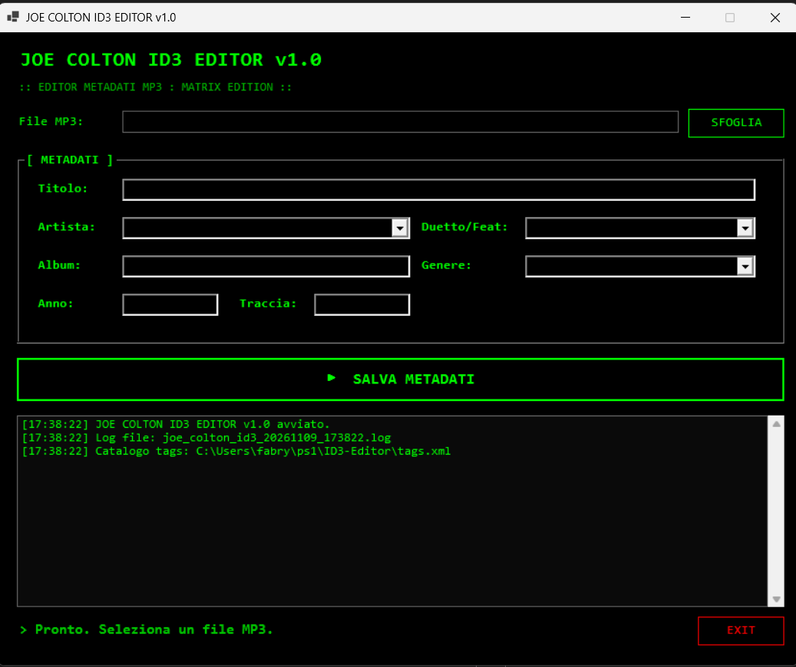

# 🎖️ ID3 Editor

> **Codename: Joe Colton** — *"L'ordine è la chiave."*

Editor avanzato di metadati ID3 per file MP3 con GUI Matrix. 
Legge, modifica e salva i tag (Artista, Album, Genere, ecc.) e impara dai tuoi file per mantenere il catalogo musicale sempre coerente e standardizzato.

## ✨ Feature

- ✅ **Interfaccia Matrix**: sfondo nero, testo verde, font Consolas.
- ✅ **Modifica ID3**: supporto per Titolo, Artista, Album, Genere, Anno e Numero Traccia.
- ✅ **Gestione Duetti**: campo dedicato per i feat. e le collaborazioni (es. *Artista feat. Artista2*).
- ✅ **Auto-Apprendimento (Opzione B)**: se incontra un nuovo Artista o Genere, lo aggiunge automaticamente al file `tags.xml`.
- ✅ **"Sanità Mentale" dei Tag**: rimuove spazi superflui e scarta valori spazzatura (es. "Unknown", "N/A").
- ✅ **Separazione Intelligente**: quando trova un duetto, estrae i nomi singoli e li aggiunge al catalogo per usi futuri.
- ✅ **Log a schermo e su file**: per tenere traccia di ogni modifica.

## 📋 Requisiti

- **Windows 10 / 11**
- **PowerShell 7.2+** (scarica da https://aka.ms/powershell)
- **Modulo TagLibCli** (installato automaticamente al primo avvio)
  - In alternativa, puoi installarlo manualmente: `Install-Module -Name TagLibCli -Scope CurrentUser`

## 🚀 Quick start

1. Clona il repo o scarica lo ZIP.
2. Fai doppio click su `avvia.bat`.
3. Seleziona un file MP3.
4. Modifica i campi desiderati.
5. Clicca **SALVA METADATI**.

## 🧠 Come funziona il catalogo `tags.xml`

Il tool si basa su un file `tags.xml` che contiene tre liste:
- `<ArtistiSingoli>`: i nomi degli artisti "puliti".
- `<Generi>`: i generi musicali standardizzati.
- `<Duetti>`: le collaborazioni già viste (es. *Fabio Concato feat. Papik*).

All'avvio, il tool popola i menu a tendina con questi valori. Se l'utente salva un file con un Artista o un Genere che non è presente nel catalogo, il tool (grazie all'**Opzione B**) lo aggiunge automaticamente al file `tags.xml`, così sarà disponibile per la prossima volta. 

Questo garantisce che la tua libreria musicale non abbia mai duplicati come "Fabio Concato", "fabio concato" o "F. Concato".

## 🎯 Casi d'uso

- Correggere i tag di un album estratto da CD (o scaricato) con i nomi sbagliati.
- Standardizzare i generi musicali per tutta la libreria.
- Gestire in modo pulito i duetti e le collaborazioni.
- Mantenere un catalogo di artisti sempre aggiornato.

## ⚠️ Attenzione

- Il tool modifica i file **in modo permanente**. Ti consigliamo di fare un backup dei tuoi file prima di modifiche massive.
- Se un tag è scritto in modo "strano" (es. tutto maiuscolo o con errori di battitura), il tool lo accetta ma lo standardizza tramite il filtro di sanità mentale (rimuove spazi, ignora valori spazzatura).
- La gestione dei duetti si basa sul riconoscimento di parole chiave come `feat.`, `&` o `vs.`. Se il duetto è scritto in modo diverso, potrebbe non essere riconosciuto automaticamente.

## 📝 Changelog

### [1.0.0] - 2026-11-09
#### Aggiunto
- GUI Matrix per la modifica dei metadati ID3.
- Lettura e scrittura dei tag tramite `TagLibCli`.
- Auto-apprendimento di nuovi Artisti e Generi nel file `tags.xml`.
- Gestione dei duetti con separazione intelligente dei nomi.
- Filtro di "sanità mentale" per i valori dei tag.
- Log a schermo e su file.

## 📜 Licenza

MIT (vedi LICENSE).

## 🙏 Crediti

- Sviluppato con PowerShell 7 + WinForms + TagLibCli.
- Fabry Toolbox.
